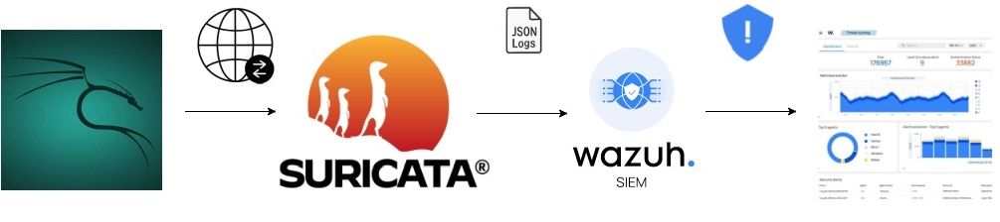

# Suricata-Wazuh SOC Lab
## Project Goal
The goal of this SOC Lab is to practice the fundamentals of security monitoring, detection, alert investigation, and basic SOC triage.

The environment consists of:

Kali Linux – generating controlled network traffic

Suricata – detecting suspicious activity (IDS)

Wazuh – collecting and analyzing security alerts

Wazuh Agent – collecting Suricata JSON logs from eve.json

Wazuh Decoder and Rules – decoding and classifying Suricata alerts

Analyst – investigating events and performing basic triage

# Architecture
  

## Test Scenarios

- **Port Scan** — `nmap -sS <TARGET>`  
  Test detection of network scanning activity.

- **Service Enumeration** — `nmap -sV <TARGET>`  
  Analyze detected ports, services, IP addresses and connection activity.

- **Web Reconnaissance** — `curl http://<TARGET>`  
  Analyze normal HTTP traffic and its visibility in the IDS.

- **Suspicious HTTP Request** — controlled HTTP request matching a Suricata rule.  
  Test the detection rule and investigate the generated alert.

## Results

| Scenario | Detection | Result |
|---|---|---|
| Port Scan | Suricata | Detected |
| Service Enumeration | Suricata | Detected |
| Web Reconnaissance | Suricata | No alert |
| Suspicious HTTP Request | Suricata | Detected |

## Skills Practiced
- IDS fundamentals
- Suricata rules
- JSON security logs
- Wazuh rules and decoders
- Alert investigation
- Network traffic analysis
- SOC triage
- False-positive analysis
- Incident documentation

## Summary

This SOC Lab provided hands-on experience with network monitoring, IDS detection, alert investigation, and basic SOC triage. The project focused on analyzing security events from network traffic through detection to alert investigation using Suricata and Wazuh.
